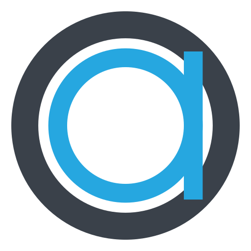

# Optimised PDF app icon



**Mark:** the Optimised Accounting logo, a blue lowercase "a" (a ring with a stem on its right) inside a
dark ring, separated by a white gap.

**Geometry** (on a 200-unit canvas, centred at 100, 100): dark disc radius 91; white disc radius 69.5;
blue ring radius 54 with a 15-unit stroke; blue stem 15 units wide, from y 41 to y 159, its right edge
flush with the ring's outer edge.

**Palette:**

| Colour | Hex | Used for |
|---|---|---|
| Slate | `#3a414a` | the outer ring (and the PDF document icon's badge) |
| Blue | `#26a7e0` | the "a" (and the document icon's text lines) |
| White | `#ffffff` | the gap between them |

**Tile:** `viewBox="0 0 512 512"` with a transparent background; the mark fills it to a 91% radius.
Windows and Linux icons use the tile as it is. macOS icons put it on Apple's grid (an 824 px body
centred on a transparent 1024 px canvas).

**Provenance:** redrawn as a vector from the company logo supplied by the owner (2026-10-12). It is a
trademark of Optimised Accounting Pty Ltd, not open source: see [LICENSE.txt](LICENSE.txt) and
[`docs/brand/LICENSE-optimised-accounting.txt`](../../docs/brand/LICENSE-optimised-accounting.txt).
The same mark is in [`docs/brand/optimised-pdf-mark.svg`](../../docs/brand/optimised-pdf-mark.svg)
(About dialog, README).

The file names keep the `pdfcraft` prefix and the Linux app id `ai.storyteller.pdfcraft`, which the
build, packaging and existing installs depend on.

## Files

| File | What it is |
|---|---|
| `pdfcraft.svg` | the master vector; every PNG, `.ico` and `.icns` is rendered from it |
| `pdfcraft-small.svg` | the same vector, used where a small file matters, such as this README |
| `pdfcraft-1024.png` | 1024 px on Apple's grid; also the runtime Dock icon on macOS |
| `pdfcraft.icns` | macOS icon (16–1024 px) |
| `pdfcraft.ico` | Windows icon (16–256 px), embedded in `pdfcraft.exe` by `apps/pdfcraft/build.rs` |
| `pdfcraft-document.svg` | Windows PDF file icon master: a Lucide document outline, slate badge, blue lines and outlined PDF lettering; no font dependency |
| `pdfcraft-document.ico` | Windows PDF file icon (16–256 px), embedded as resource 2 in `pdfcraft.exe` |
| `hicolor/<n>x<n>/apps/ai.storyteller.pdfcraft.png` | Linux hicolor theme, 16–512 px; the 256 px one is the runtime icon on Windows and Linux |
| `hicolor/scalable/apps/ai.storyteller.pdfcraft.svg` | Linux scalable icon (copy of the master) |

Where it shows: `apps/pdfcraft/src/main.rs` sets the window icon (Dock, taskbar, Alt-Tab, launcher) and the
Wayland app id `ai.storyteller.pdfcraft`; `packaging/linux/ai.storyteller.pdfcraft.desktop` names the
hicolor icon.

Windows PDF files use resource 2 (`"pdfcraft.exe",-2`) when Optimised PDF is chosen as the default
reader; the app keeps resource 1. The document outline is adapted from Lucide `file-text`
1.49.0 (ISC); its badge and outlined lettering are original (`MIT OR Apache-2.0`), covered by
[LICENSE-document.txt](LICENSE-document.txt). Both icons are embedded, requiring no runtime
sidecar. This provides a file type icon; first-page thumbnails still need a thumbnail provider.

## Regenerate

```sh
packaging/icons.sh        # needs resvg and python3; iconutil (macOS) for the .icns
cargo xtask assets        # then update the sha256 values in ATTRIBUTION.toml and run with --write
```

On Windows without `iconutil`, the `.icns` can be written from `pdfcraft-1024.png` with Pillow
(`Image.save("pdfcraft.icns", sizes=[(16, 16), …, (1024, 1024)])`).
